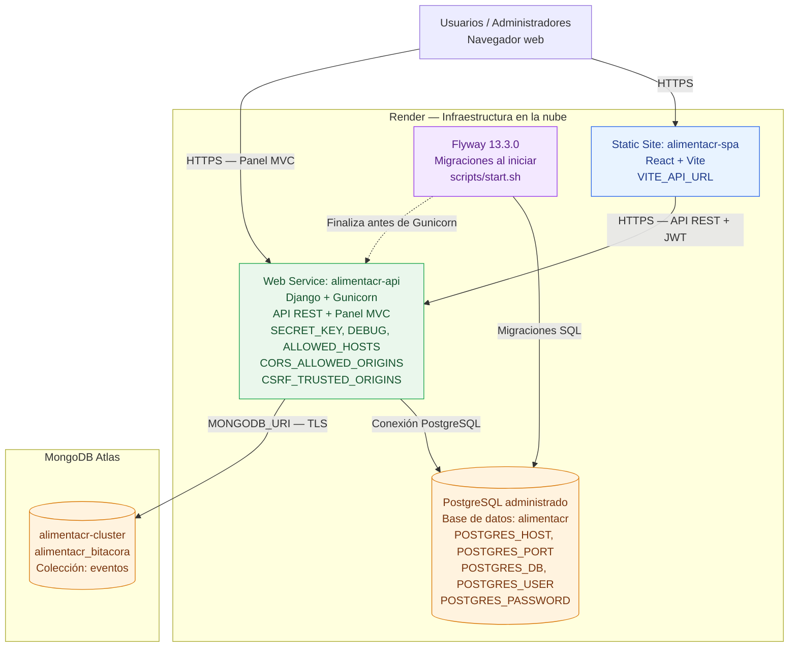

# Diagrama de despliegue — AlimentaCR

**Curso:** EIF509 — Desarrollo de Aplicaciones Basadas en Web  
**Laboratorio:** 6 — Presentación y despliegue en la nube

## Arquitectura desplegada

## Descripción de los componentes

| Componente | Plataforma | Función |
|---|---|---|
| SPA React | Render Static Site | Interfaz de usuarios finales. |
| API REST | Render Web Service | Servicios HTTP, autenticación JWT y reglas de negocio. |
| Panel MVC | Render Web Service | Vistas administrativas generadas mediante Django Templates. |
| Flyway | Contenedor del backend | Aplica migraciones de PostgreSQL antes del inicio de Gunicorn. |
| PostgreSQL | Render PostgreSQL | Almacena la información transaccional del dominio. |
| MongoDB | MongoDB Atlas | Almacena los eventos de la bitácora. |

## Configuración de variables de entorno

Las variables de entorno se administran en los servicios correspondientes:

**Render — alimentacr-api**

- `SECRET_KEY`
- `DEBUG`
- `ALLOWED_HOSTS`
- `POSTGRES_HOST`
- `POSTGRES_PORT`
- `POSTGRES_DB`
- `POSTGRES_USER`
- `POSTGRES_PASSWORD`
- `MONGODB_URI`
- `MONGO_DATABASE`
- `CORS_ALLOWED_ORIGINS`
- `CSRF_TRUSTED_ORIGINS`

**Render — alimentacr-spa**

- `VITE_API_URL`

**Entorno local**

- `.env` para la configuración de Django y las bases de datos.
- `docker-compose.yml` para los servicios locales de PostgreSQL, MongoDB y Flyway.

Los valores sensibles se mantienen fuera del repositorio.

## Secuencia de arranque del backend

1. Render inicia el contenedor de `alimentacr-api`.
2. El script `scripts/start.sh` ejecuta Flyway.
3. Flyway valida y aplica las migraciones pendientes en PostgreSQL.
4. Finalizadas correctamente las migraciones, el script inicia Gunicorn.
5. Gunicorn publica la aplicación Django.
6. La API y el panel MVC quedan disponibles para atender solicitudes HTTPS.

## Enlaces de producción

| Servicio | URL |
|---|---|
| SPA React | https://alimentacr-spa.onrender.com |
| API Django | https://alimentacr-api.onrender.com |
| Swagger UI | https://alimentacr-api.onrender.com/api/docs/ |
| Panel MVC | https://alimentacr-api.onrender.com/panel/ |
