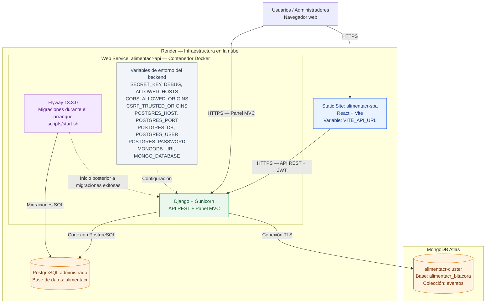

# Diagrama de despliegue — AlimentaCR

**Curso:** EIF509 — Desarrollo de Aplicaciones Basadas en Web  
**Laboratorio:** 6 — Presentación y despliegue en la nube

## Arquitectura desplegada

## Descripción de los componentes

| Componente | Plataforma | Función |
|---|---|---|
| SPA React | Render Static Site | Interfaz de usuarios finales que consume la API REST. |
| API REST | Render Web Service | Servicios HTTP, autenticación JWT y ejecución de las reglas de negocio. |
| Panel MVC | Render Web Service | Vistas administrativas generadas mediante Django Templates. |
| Flyway | Contenedor Docker del backend | Valida y aplica las migraciones de PostgreSQL antes del inicio de Gunicorn. |
| PostgreSQL | Render PostgreSQL | Almacena la información transaccional del dominio. |
| MongoDB | MongoDB Atlas | Almacena los eventos de la bitácora. |

## Configuración de variables de entorno

Las variables de entorno se administran en los servicios correspondientes. Los valores sensibles no se almacenan directamente en el código fuente.

### Render — alimentacr-api

El servicio web de Django utiliza las siguientes variables:

**Configuración de Django y seguridad:**

- `SECRET_KEY`
- `DEBUG`
- `ALLOWED_HOSTS`
- `CORS_ALLOWED_ORIGINS`
- `CSRF_TRUSTED_ORIGINS`

**Conexión con PostgreSQL:**

- `POSTGRES_HOST`
- `POSTGRES_PORT`
- `POSTGRES_DB`
- `POSTGRES_USER`
- `POSTGRES_PASSWORD`

**Conexión con MongoDB Atlas:**

- `MONGODB_URI`
- `MONGO_DATABASE`

Estas variables permiten que el backend se conecte a los servicios administrados sin incorporar credenciales directamente en el repositorio.

### Render — alimentacr-spa

La aplicación React utiliza:

- `VITE_API_URL`

Esta variable establece la dirección pública de la API REST que consume la SPA.

### Entorno local

En desarrollo se utilizan:

- `.env` para la configuración de Django y las conexiones a las bases de datos.
- `docker-compose.yml` para ejecutar PostgreSQL, MongoDB y Flyway localmente.
- `.env.example` como referencia de las variables necesarias.

Las credenciales, claves privadas y cadenas de conexión sensibles deben mantenerse fuera del repositorio.

## Secuencia de arranque del backend

El backend utiliza un contenedor Docker que incorpora Django, Gunicorn y Flyway.

La secuencia de arranque es la siguiente:

1. Render inicia el contenedor del servicio `alimentacr-api`.
2. Se ejecuta el script `scripts/start.sh`.
3. El script inicia Flyway y establece la conexión con PostgreSQL.
4. Flyway valida el historial de migraciones y aplica aquellas que estén pendientes.
5. Una vez finalizadas correctamente las migraciones, se inicia Gunicorn.
6. Gunicorn publica la aplicación Django.
7. La API REST y el panel administrativo MVC quedan disponibles para atender solicitudes HTTPS.

Este procedimiento permite automatizar la actualización del esquema relacional antes de poner en funcionamiento el backend.

## Comunicación entre componentes

### Navegador y SPA React

Los usuarios acceden a la SPA mediante HTTPS.

React se ejecuta en el navegador y consume la API REST utilizando la dirección configurada mediante `VITE_API_URL`.

Las operaciones protegidas utilizan autenticación mediante JWT.

### Navegador y panel MVC

Los administradores acceden directamente al panel MVC del backend.

Django procesa las solicitudes, aplica las validaciones y genera las respuestas HTML mediante su sistema de plantillas.

Los formularios utilizan protección CSRF.

### Backend y PostgreSQL

Django se conecta a PostgreSQL mediante las variables de entorno configuradas en el servicio web.

PostgreSQL almacena las entidades transaccionales del dominio, incluyendo organizaciones, usuarios, categorías, donaciones, solicitudes y entregas.

Flyway utiliza la conexión a PostgreSQL para administrar las migraciones versionadas del esquema relacional.

### Backend y MongoDB Atlas

Django utiliza `MONGODB_URI` para establecer una conexión segura con MongoDB Atlas.

La base de datos `alimentacr_bitacora` contiene la colección `eventos`, utilizada para registrar las operaciones relevantes del sistema.

## Enlaces de producción

| Servicio | URL |
|---|---|
| SPA React | https://alimentacr-spa.onrender.com |
| API Django | https://alimentacr-api.onrender.com |
| Swagger UI | https://alimentacr-api.onrender.com/api/docs/ |
| Panel MVC | https://alimentacr-api.onrender.com/panel/ |

---

**Universidad Nacional de Costa Rica — EIF509 Desarrollo de Aplicaciones Basadas en Web — Laboratorio 6 — II Ciclo 2026.**