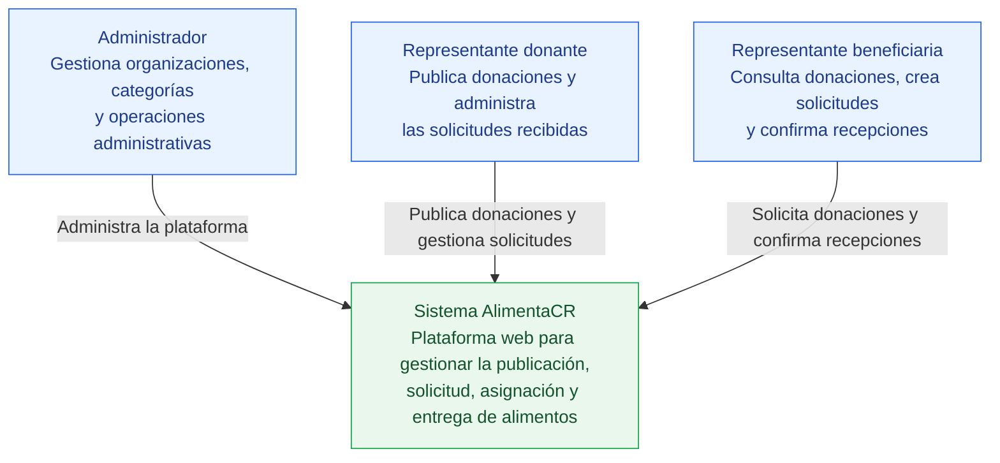
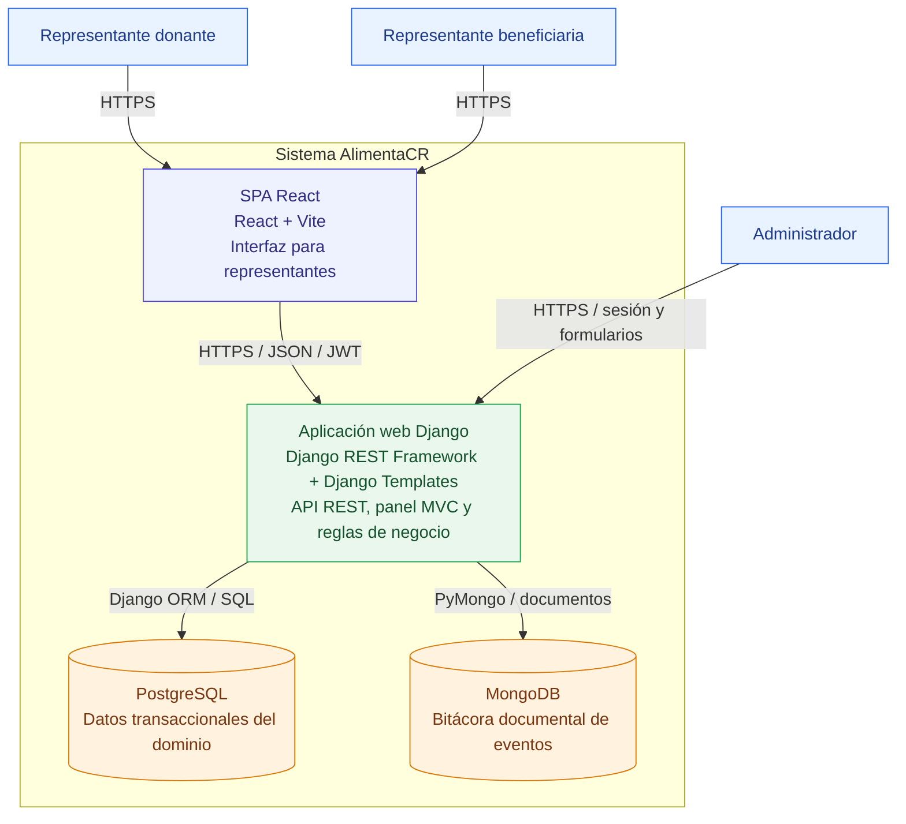
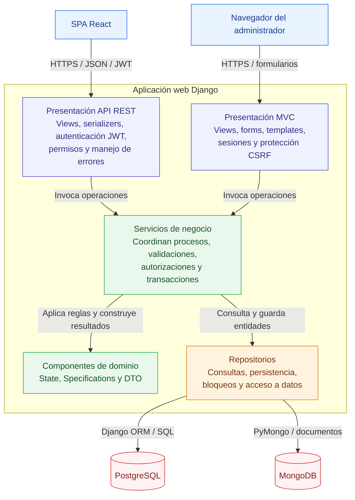

# Modelo C4 de AlimentaCR

## 1. Introducción

Este documento describe la arquitectura de AlimentaCR utilizando el modelo C4, el cual permite representar el sistema mediante distintos niveles de abstracción.

El modelo incluye:

- Nivel 1: contexto del sistema.
- Nivel 2: contenedores.
- Nivel 3: componentes principales del backend.

No se incluye el nivel 4 de código porque la estructura de paquetes, clases y pruebas automatizadas ya proporciona ese grado de detalle directamente en el repositorio.

Los diagramas representan la arquitectura lógica del sistema. La distribución física de los servicios en producción se documenta por separado en el [diagrama de despliegue](diagrama-despliegue.md).

---

## 2. Nivel 1 — Diagrama de contexto

### 2.1. Propósito

El diagrama de contexto presenta AlimentaCR como un único sistema y muestra las personas que interactúan con él.

### 2.2. Personas

| Persona | Responsabilidad |
|---|---|
| Administrador | Gestiona organizaciones, categorías y operaciones administrativas. |
| Representante donante | Publica donaciones, consulta solicitudes y selecciona una organización beneficiaria. |
| Representante beneficiaria | Consulta donaciones, crea o cancela solicitudes y participa en la confirmación de entregas. |

### 2.3. Sistema de interés

AlimentaCR centraliza la gestión de donaciones de alimentos entre organizaciones donantes y beneficiarias.

El sistema administra el proceso desde la publicación de una donación hasta su solicitud, asignación y entrega. También conserva trazabilidad de las acciones relevantes mediante una bitácora de eventos.

AlimentaCR registra la coordinación de las entregas, pero no administra el transporte físico, las rutas ni los controles sanitarios de los alimentos.

---

## 3. Nivel 2 — Diagrama de contenedores

### 3.1. Propósito

El diagrama de contenedores muestra las aplicaciones y almacenes de datos que conforman AlimentaCR.

En el modelo C4, un contenedor representa una aplicación ejecutable o un almacén de datos. No necesariamente corresponde a un contenedor Docker.

### 3.2. Contenedores

| Contenedor | Tecnología | Responsabilidad |
|---|---|---|
| SPA React | React y Vite | Proporciona la interfaz para representantes donantes y beneficiarios. Consume la API REST mediante HTTPS. |
| Aplicación web Django | Python, Django, Django REST Framework y Gunicorn | Expone la API REST, renderiza el panel MVC, autentica usuarios y ejecuta los procesos de negocio. |
| PostgreSQL | PostgreSQL | Conserva organizaciones, usuarios, categorías, donaciones, solicitudes y entregas. |
| MongoDB | MongoDB | Conserva la colección documental de eventos utilizada como bitácora. |

### 3.3. Relaciones principales

#### Representantes y SPA

Los representantes donantes y beneficiarios utilizan la SPA React desde el navegador.

La SPA envía solicitudes HTTPS a la API y utiliza autenticación mediante JWT para las operaciones protegidas.

#### Administrador y aplicación Django

El administrador accede directamente al panel MVC integrado en Django.

El panel utiliza vistas, formularios y plantillas renderizadas en el servidor. La autenticación se mantiene mediante una sesión firmada en cookie y los formularios utilizan protección CSRF.

#### Django y PostgreSQL

Django utiliza su ORM y los repositorios de la capa de datos para consultar y modificar las entidades transaccionales.

El esquema relacional se administra mediante migraciones Flyway.

#### Django y MongoDB

Django utiliza PyMongo para registrar eventos en la colección documental.

MongoDB conserva el historial de acciones relevantes, mientras que PostgreSQL conserva el estado actual de las entidades.

### 3.4. Consideraciones de despliegue

En producción:

- La SPA se publica como un sitio estático en Render.
- Django se ejecuta como un servicio web en Render.
- PostgreSQL se utiliza como servicio administrado.
- MongoDB se ejecuta en MongoDB Atlas.
- Gunicorn ejecuta la aplicación Django.
- Flyway aplica las migraciones antes del inicio de Gunicorn.
- La configuración se proporciona mediante variables de entorno.

La organización física de estos servicios se encuentra en el [diagrama de despliegue](diagrama-despliegue.md).

---

## 4. Nivel 3 — Diagrama de componentes del backend

### 4.1. Propósito

El diagrama de componentes amplía el contenedor de la aplicación Django y muestra sus responsabilidades internas principales.

Este nivel se concentra en el backend porque contiene las reglas del dominio, la autenticación, la autorización y la coordinación de la persistencia.

### 4.2. Componentes

| Componente | Ubicación principal | Responsabilidad |
|---|---|---|
| Presentación API REST | `presentation/` | Recibe solicitudes HTTP, valida entradas, autentica tokens JWT, aplica permisos y construye respuestas JSON. |
| Presentación MVC | `presentation/web/` | Atiende el panel administrativo mediante vistas, formularios y plantillas Django. |
| Servicios de negocio | `business/services/` | Coordina los casos de uso, reglas, autorizaciones, transacciones y registro de eventos. |
| State | `business/states/` | Controla las transiciones permitidas de las solicitudes según su estado actual. |
| Specifications | `business/specifications/` | Encapsula reglas de publicación y criterios reutilizables de consulta. |
| DTO | `business/dto/` | Define contratos de salida y reduce la exposición directa de entidades ORM. |
| Repositorios | `data/repositories/` | Encapsula consultas, persistencia, optimizaciones, bloqueos y acceso a PostgreSQL o MongoDB. |
| Modelos | `data/models/` | Mapea mediante Django ORM las tablas administradas por Flyway. |

### 4.3. Presentación API REST

La presentación REST contiene:

- Vistas y controladores HTTP.
- Serializadores de entrada y salida.
- Autenticación JWT.
- Permisos por rol.
- Restricciones por organización.
- Manejo global de excepciones.
- Documentación OpenAPI.

Su responsabilidad es interpretar las solicitudes y delegar la ejecución de los procesos en la capa de negocio.

Las reglas del dominio no deben implementarse exclusivamente en las vistas o serializadores.

### 4.4. Presentación MVC

El módulo MVC contiene:

- Vistas administrativas.
- Formularios.
- Plantillas HTML.
- Sesiones administrativas.
- Protección CSRF.
- Navegación y redirecciones.

Este componente reutiliza los servicios existentes y no implementa una segunda versión de la lógica del dominio.

### 4.5. Servicios de negocio

Los servicios funcionan como puntos de entrada para los procesos del sistema.

Entre ellos se encuentran:

- `AuthService`.
- `CategoriaService`.
- `DonacionService`.
- `EntregaService`.
- `OrganizacionService`.
- `SolicitudService`.
- `UsuarioService`.

Los servicios coordinan las validaciones, los permisos relacionados con los recursos, las transacciones y las llamadas a los repositorios.

Por ejemplo, la aceptación de una solicitud:

1. Verifica la solicitud y la donación.
2. Bloquea la donación para evitar modificaciones concurrentes.
3. Valida el estado mediante State.
4. Comprueba que el usuario pertenezca a la organización donante.
5. Rechaza las demás solicitudes pendientes.
6. Asigna la donación.
7. Crea la entrega.
8. Registra el evento correspondiente.

### 4.6. Componentes de dominio

#### State

Centraliza las transiciones de las solicitudes entre los estados `PENDIENTE`, `ACEPTADA`, `RECHAZADA` y `CANCELADA`.

#### Specification

Representa reglas independientes, como comprobar que una organización pueda donar, que una categoría esté activa, que la cantidad sea positiva o que la fecha límite sea futura.

También permite construir criterios reutilizables para filtrar donaciones y solicitudes.

#### DTO

Representa los resultados de las operaciones principales sin entregar directamente las entidades ORM a la presentación.

### 4.7. Repositorios

Los repositorios encapsulan las operaciones de persistencia y proporcionan una interfaz utilizada por los servicios.

Entre sus responsabilidades se encuentran:

- Consultas por identificador.
- Listados y filtros.
- Persistencia de entidades.
- Uso de `select_related()` para evitar consultas N+1.
- Uso de `select_for_update()` para controlar concurrencia.
- Registro de eventos en MongoDB.

Los servicios pueden recibir repositorios mediante sus constructores, lo que permite sustituirlos por dobles durante las pruebas unitarias.

---

## 5. Flujo arquitectónico principal

Una operación iniciada desde React sigue normalmente este recorrido:

1. El usuario ejecuta una acción en la SPA.
2. React envía una solicitud HTTPS a la API REST.
3. La presentación valida la entrada, autentica al usuario y comprueba los permisos generales.
4. La vista invoca el servicio de negocio correspondiente.
5. El servicio aplica las reglas mediante State o Specifications cuando corresponde.
6. El servicio utiliza repositorios para consultar o modificar la información.
7. PostgreSQL conserva el estado transaccional.
8. MongoDB registra el evento cuando la operación requiere trazabilidad.
9. El servicio devuelve un DTO o resultado.
10. La presentación construye la respuesta HTTP.
11. React presenta el resultado al usuario.

Una operación iniciada desde el panel administrativo sigue el mismo flujo desde la capa de negocio hacia abajo, pero la presentación utiliza vistas, formularios y plantillas Django en lugar de JSON.

---

## 6. Decisiones relacionadas

Las decisiones que justifican esta arquitectura se encuentran en:

- [ADR-001 — Selección del stack backend](../adr/ADR-001-seleccion-stack-backend.md)
- [ADR-002 — Persistencia políglota](../adr/ADR-002-persistencia-poliglota-postgresql-mongodb.md)
- [ADR-003 — Patrones de diseño](../adr/ADR-003-patrones-de-diseno.md)
- [ADR-004 — Dominio y alcance](../adr/ADR-004-dominio-y-alcance-alimentacr.md)
- [ADR-005 — Estrategia de autenticación](../adr/ADR-005-estrategia-autenticacion.md)
- [ADR-006 — Plataforma y despliegue](../adr/ADR-006-plataforma-y-estrategia-de-despliegue.md)

---

## 7. Documentación relacionada

- [Propuesta de dominio](../Propuesta-Dominio.md)
- [Modelo relacional](../modelo-datos/modelo-relacional.md)
- [Modelo MongoDB](../modelo-datos/modelo-mongodb.md)
- [Capa de negocio](capa-negocio.md)
- [Diagrama de despliegue](diagrama-despliegue.md)
- [Documentación del Laboratorio 6](../despliegue/lab6.md)

---

## 8. Alcance del modelo

Este modelo C4 representa la arquitectura actual de AlimentaCR.

El nivel de contexto muestra a las personas y el sistema completo. El nivel de contenedores muestra las aplicaciones y almacenes de datos. El nivel de componentes muestra la organización interna del backend Django.

Los detalles de clases, métodos y pruebas permanecen en el código fuente y no se duplican mediante un diagrama de nivel 4.